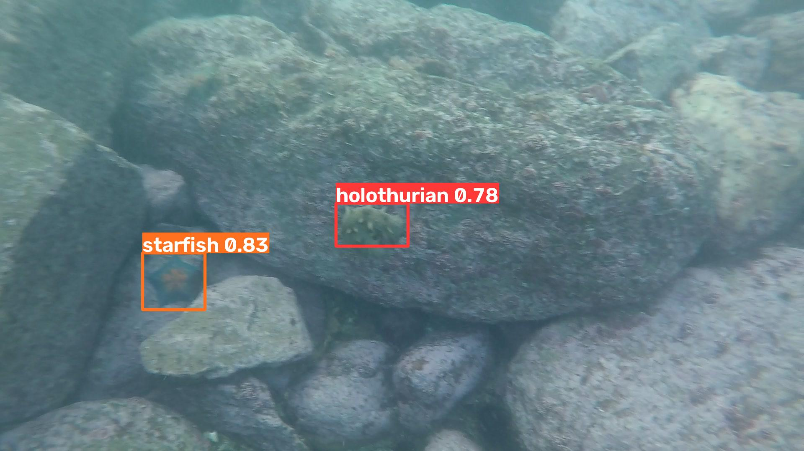

# OceanEye

**Underwater species detection with a state-space YOLO model.** OceanEye finds sea cucumbers, sea urchins, starfish and scallops in underwater images and video, draws a box around each one, and names it. It runs offline on a single CUDA GPU.



We built OceanEye for the **2026 World Vocational College Skills Competition** in Phnom Penh, Cambodia (20 to 22 September 2026).

**Team:** Eng Dararoth, PovChomreoun Yuleang and Sopheak Sophearoth, Royal University of Phnom Penh.

## Model

The detector is a YOLOv8 network with Mamba state-space (VSSM) blocks in its backbone. State-space layers read context across the whole frame, and their cost grows in proportion to image size, where attention grows with its square.

| | |
|---|---|
| Parameters | 72.4 M |
| Input size | 640 x 640 |
| Classes | `holothurian` (sea cucumber), `echinus` (sea urchin), `starfish`, `scallop` |
| Training data | URPC2021 underwater dataset |
| Weights | [`model/best.pt`](model/best.pt), 145 MB, stored with Git LFS |

Validation results at the best epoch ([`model/results.csv`](model/results.csv)):

| Precision | Recall | mAP@0.5 | mAP@0.5:0.95 |
|:-:|:-:|:-:|:-:|
| 0.821 | 0.817 | **0.867** | 0.522 |

## How it works

```
image / video / live stream -> contrast enhancement (optional) -> detector -> web dashboard
```

- **Pure-PyTorch selective scan.** The state-space layers run on a two-level parallel scan written in plain PyTorch ([`selective_scan_fallback.py`](selective_scan_fallback.py)). The model needs no compiled CUDA extension and runs on current PyTorch with any CUDA GPU it supports.
- **1.13 s per image.** The parallel scan halves inference time compared with a step-by-step scan (2.30 s).
- **Real-time video.** Detection runs on a worker thread, so the stream holds about 26 fps while boxes refresh about once per second.
- **Contrast enhancement.** A CLAHE toggle helps in murky water and hurts in clear water, so the dashboard leaves it off by default.

The Flask dashboard has three modes: Image Detection, Video Detection and Real-time Monitoring.

## Run it

You need Linux, Python 3.11, an NVIDIA GPU with CUDA 12.8 drivers and 2 GB of free VRAM, and [Git LFS](https://git-lfs.com).

```bash
git lfs install
git clone https://github.com/Dararoth-ML/oceaneye.git
cd oceaneye
python3.11 -m venv .venv && source .venv/bin/activate
pip install torch torchvision --index-url https://download.pytorch.org/whl/cu128
pip install -e . einops timm flask flask-session
```

If `model/best.pt` is a few hundred bytes, run `git lfs pull`.

Check the model (timing varies by GPU):

```bash
python verify_model.py
```

```
inference: 1.13 s
detections: 2
   starfish       0.83
   holothurian    0.78
```

Start the dashboard with `python app/app.py` and open <http://localhost:8080>. The login accepts any username and password.

## Limitations

- The model detects four species and can mislabel other objects as one of them.
- Counts come from single frames. OceanEye does not track individual animals.
- Accuracy drops on footage that looks different from the training data, such as clear water or unusual lighting.
- The login page is a placeholder with no authentication.

## References

- Li Kaixuan, *基于深度学习的水下图像超分辨率重建与目标检测方法研究* (Research on Deep-Learning Methods for Underwater Image Super-Resolution Reconstruction and Object Detection), undergraduate thesis supervised by Prof. Wang Li, Nanjing Vocational University of Industry Technology, 2026.

## License

OceanEye is released under [AGPL-3.0](LICENSE). Some files also carry [Apache-2.0](LICENSE-APACHE).
